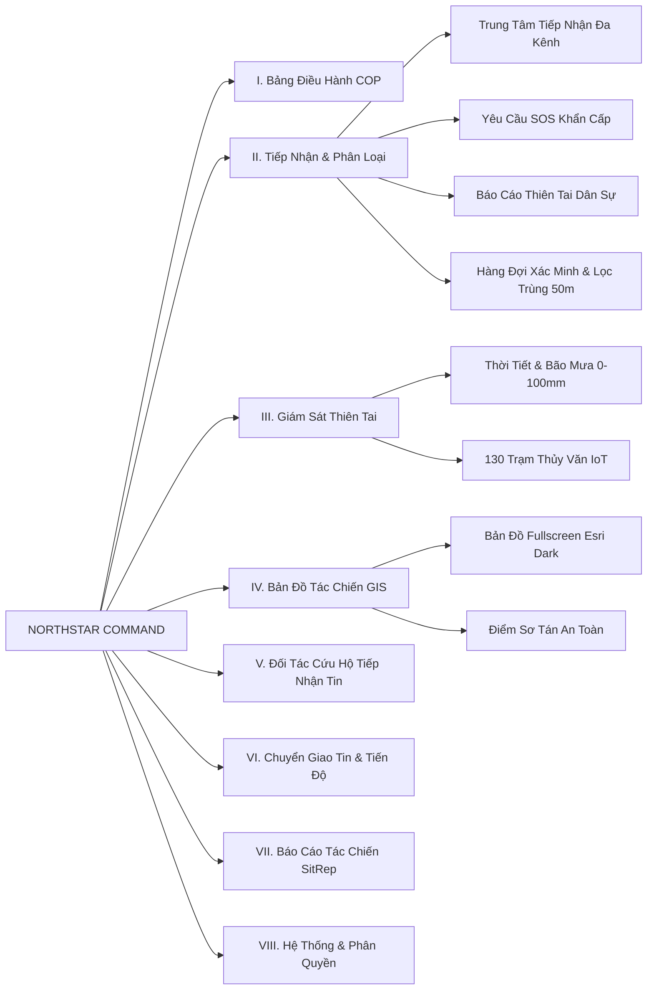

# 🧭 NORTHSTAR COMMAND – Trung Tâm Tiếp Nhận Dữ Liệu & Chuyển Giao Thông Tin Cứu Nạn

[](https://opensource.org/licenses/Apache-2.0)
[](https://opensource.org/licenses)
[](https://leafletjs.com/)
[](https://server.arcgisonline.com)
[](https://web.dev/progressive-web-apps/)
[](https://tailwindcss.com/)

> **NORTHSTAR COMMAND** là phân hệ trung tâm đầu não của nền tảng NORTHSTAR.  
> Hệ thống đảm nhận vai trò **Trung tâm Tiếp nhận Thông tin Thiên tai, Xử lý Tình báo Hiện trường và Đóng gói, Chuyển giao Dữ liệu Tác chiến cho Lực lượng Cứu nạn Cứu hộ Thực địa (PCCC 114, Cấp cứu 115, Chữ Thập Đỏ, Đoàn xe 4x4, Đội Thợ lặn)**.

---

## 🎯 1. Định Vị Nghiệp Vụ Cốt Lõi

Hệ thống giải quyết bài toán đứt gãy thông tin giữa **Người dân gặp nạn** và **Lực lượng cứu hộ thực địa**:
1. **Không phải lực lượng trực tiếp cứu nạn:** NORTHSTAR COMMAND là trung tâm tiếp nhận, sàng lọc, phân tích và điều phối dữ liệu; không trực tiếp vận hành phương tiện trên sông lũ.
2. **Tiếp nhận đa kênh toàn diện:** Thu thập mọi tín hiệu SOS từ người dân, tin báo ngập/sạt lở cộng đồng, cuộc gọi chuyển tiếp từ Tổng đài 114, số liệu trạm quan trắc thủy văn IoT và ảnh viễn thám vệ tinh radar Sentinel-1 SAR.
3. **Thẩm định & Khử trùng lặp 50m (Spatial Deduplication):** Tự động gom cụm các tin báo gần nhau trong bán kính 50m, tránh tình trạng nhiều đội cứu hộ cùng đổ dồn về một vị trí trong khi các điểm khác bị bỏ sót.
4. **Đóng gói & Chuyển giao thông tin cần thiết:** Cung cấp đầy đủ thông tin chuẩn hóa (tọa độ GPS, link Google Maps, số lượng nạn nhân, người già/trẻ em, mực nước ngập, lộ trình an toàn né ngập A*, điểm sơ tán chỉ định) cho bên cứu hộ qua 3 phương thức: **Số hóa trực tiếp**, **Sao chép Zalo/SMS 1-chạm** và **Phiếu lệnh tác chiến QR Code**.

---

## 👥 2. Ma Trận Phân Quyền Tác Chiến 6 Vai Trò (RBAC Matrix)

Hệ thống phân định nghiêm ngặt quyền hạn tác chiến và phạm vi bao quát giữa các vai trò trực ban:

| Vai Trò | Tên Hiển Thị | Phạm Vi Bao Quát (Overview Scope) | Xuất Quân | Thẩm Định | Xe/Tàu | Trú Ẩn | Giả Lập Bão | SitRep | Quản Trị RBAC |
|---|---|---|:---:|:---:|:---:|:---:|:---:|:---:|
| `director` | ⭐ Chỉ huy trưởng | Toàn chiến dịch Miền Bắc (155 điểm ngập, 130 trạm đo, 5 đội cứu hộ, 15 điểm sơ tán). Ban bố tình trạng khẩn cấp toàn khu vực. | **✓** | **✓** | **✓** | **✓** | **✓** | **✓** | **✓** |
| `dispatcher` | 🛡️ Điều phối viên | Tiếp nhận SOS, lập lệnh xuất quân, phân bổ ca-nô/xe 4x4, tính toán lộ trình cứu hộ né ngập TSP. | **✓** | **✓** | **✓** | **✓** | 🔒 | **✓** | 🔒 |
| `verifier` | 🔍 Xác minh viên | Thẩm định tin báo dân sự, kiểm tra ảnh hiện trường, lọc trùng 50m, đối soát 114 (Tuyệt đối không tự ý xuất quân). | 🔒 | **✓** | 🔒 | 🔒 | 🔒 | 🔒 | 🔒 |
| `analyst` | 📊 Chuyên viên dữ liệu | Giám sát 130 trạm thủy văn IoT, radar mưa Open-Meteo, viễn thám Sentinel-1 SAR, chạy mô phỏng bão lũ 0-100mm. | 🔒 | 🔒 | 🔒 | 🔒 | **✓** | **✓** | 🔒 |
| `rescue_coordinator` | 🚒 Đ/p Cứu hộ | Chỉ huy 5 đơn vị cơ động (Ca-nô 150HP, Xuồng phao, Xe 4x4, Thợ lặn, Trực thăng Mi-17), theo dõi cứu nạn P1. | **✓** | 🔒 | **✓** | 🔒 | 🔒 | 🔒 | 🔒 |
| `relief_coordinator` | 📦 Đ/p Cứu trợ | Quản lý 15 điểm sơ tán an toàn (420/600 người, công suất 70%), kho hàng 1,200 thùng nước, 850 thùng lương khô, 500 áo phao. | 🔒 | 🔒 | 🔒 | **✓** | 🔒 | **✓** | 🔒 |

---

## 🏛️ 3. Danh Mục 14 Phân Hệ Tác Chiến



1. **Bảng Điều Hành Tác Chiến COP (`cmd_dashboard`):** Toàn cảnh bức tranh cứu hộ thời gian thực, 5 thẻ chỉ số chiến lược (SOS Khẩn Cấp, Chờ Tiếp Nhận, Đang Điều Phối, Lực Lượng Trực, Điểm Trú Ẩn), bản đồ Leaflet tích hợp và dòng tin trực tiếp.
2. **Trung Tâm Tiếp Nhận Đa Kênh (`cmd_intake`):** Bảng tổng hợp dòng dữ liệu từ mọi nguồn (SOS, Dân báo, Hotline 114, Cảm biến IoT, Vệ tinh SAR) với bộ lọc chuyên dụng và nút `[📤 Gửi tin cứu hộ]`.
3. **Yêu Cầu SOS Khẩn Cấp (`cmd_sos`):** Hàng đợi phân cấp P1/P2/P3, tích hợp nút gọi điện, định vị bản đồ và nút sao chép `[📋 Zalo]` định dạng chuẩn.
4. **Báo Cáo Thiên Tai Dân Sự (`cmd_reports`):** Lưới các báo cáo sạt lở, ngập úng kèm độ sâu ước tính (cm), ảnh hiện trường và thao tác duyệt/bác bỏ.
5. **Hàng Đợi Xác Minh & Lọc Trùng 50m (`cmd_verification`):** Thuật toán gom cụm không gian 50m tránh chia cắt quân, đối soát AI và thẩm định chéo.
6. **Thời Tiết & Giả Lập Bão Mưa (`cmd_weather`):** Dữ liệu nhiệt độ, lượng mưa thời gian thực 7 tỉnh Miền Bắc từ Open-Meteo và thanh trượt mô phỏng mưa bão 0–100mm.
7. **130 Trạm Thủy Văn & Lũ (`cmd_flood_intel`):** Giám sát mực nước tự động lưu vực Sông Hồng, Sông Lô, Sông Thao, Sông Đà, phân cấp theo 3 mức Báo Động (BĐ1, BĐ2, BĐ3).
8. **Bản Đồ Tác Chiến Fullscreen GIS (`cmd_disaster_map`):** Bản đồ tác chiến mở rộng 100% diện tích màn hình, hỗ trợ chuyển đổi lớp nền (Esri Dark Canvas, OSM Chuẩn, OSM Quốc Tế, Vệ Tinh Esri).
9. **Đơn Vị Cứu Hộ Tiếp Nhận & Xe (`cmd_rescue_teams`):** Danh bạ 5 đơn vị cứu hộ cơ động (Ca-nô 114, Xuồng phao Chữ Thập Đỏ, Xe tải 4x4, Đội thợ lặn, Trực thăng Mi-17) kèm trạng thái sẵn sàng chiến đấu.
10. **Điểm Sơ Tán An Toàn (`cmd_safe_zones`):** Mạng lưới 15 điểm sơ tán kiên cố kèm thanh tiến độ sức chứa và kho nhu yếu phẩm (nước sạch, lương khô, áo phao).
11. **Chuyển Giao Tin & Phân Tuyến (`cmd_operations`):** Theo dõi tiến độ nhiệm vụ cứu hộ từ lúc gửi tin đến khi giải cứu thành công (`en_route` ➔ `on_scene` ➔ `resolved`).
12. **Báo Cáo Tác Chiến SitRep (`cmd_sitrep`):** Tự động sinh báo cáo tình hình tác chiến chuẩn quân sự/cứu nạn khẩn cấp, hỗ trợ in ấn và xuất văn bản.
13. **Phân Quyền Vai Trò RBAC (`cmd_roles`):** Bảng ma trận so sánh quyền hạn tác chiến, cho phép kích hoạt vai trò trực ban chỉ với 1 cú click.
14. **Cổng Dân Sự Preview (`cmd_citizen_preview`):** Khung mô phỏng ứng dụng người dân (A* né ngập, gửi SOS giọng nói, tra cứu điểm trú ẩn).

---

## 📤 4. Quy Trình Chuyển Giao Thông Tin Cho Đội Cứu Hộ

Khi cán bộ điều phối nhấn **`[📤 Gửi Tin Cứu Hộ]`**, cửa sổ tác chiến sẽ tự động đóng gói dữ liệu:

- **1. Thông tin nạn nhân:** Họ tên, SĐT, số người mắc kẹt, tình trạng người già, trẻ nhỏ hoặc người bệnh.
- **2. Tọa độ chính xác:** Tọa độ GPS chuẩn WGS84 kèm nút tạo nhanh đường link Google Maps dẫn đường trực tiếp.
- **3. Hiện trạng thiên tai:** Mực nước ngập sâu bao nhiêu cm, kẹt trên mái nhà hay tầng 1, dòng chảy xiết.
- **4. Lộ trình an toàn né ngập:** Gợi ý tuyến đường di chuyển khô ráo được tính toán bởi thuật toán A* né các đoạn ngập sâu >30cm.
- **5. Điểm sơ tán chỉ định:** Tên trường học hoặc nhà văn hóa an toàn gần nhất để đưa nạn nhân về.
- **6. Kênh gửi đa phương thức:**
  - `[📤 Gửi Lệnh Điện Tử Trực Tiếp]`: Đẩy gói tin qua hệ thống số hóa của đội phản ứng nhanh.
  - `[📋 Sao Chép Gói Tin Zalo/SMS]`: 1 cú click sao chép toàn bộ nội dung chuẩn hóa để dán ngay vào Zalo/SMS của Chỉ huy đội cứu hộ.

---

## 🛠️ 5. Cài Đặt & Chạy Thử Nghiệm

Frontend hoạt động hoàn toàn trên trình duyệt tĩnh, không cần build step phức tạp:

```bash
# 1. Di chuyển vào thư mục Frontend
cd GrassTouchers-Frontend

# 2. Khởi chạy HTTP Server (Port 3000)
python -m http.server 3000
```

Mở trình duyệt tại: **`http://localhost:3000`**

### Chuyển đổi nhanh vai trò qua URL:
- Chỉ huy trưởng: `http://localhost:3000/?role=director`
- Xác minh viên: `http://localhost:3000/?role=verifier`
- Chuyên viên dữ liệu: `http://localhost:3000/?role=analyst`
- Điều phối cứu hộ: `http://localhost:3000/?role=rescue_coordinator`
- Điều phối cứu trợ: `http://localhost:3000/?role=relief_coordinator`
