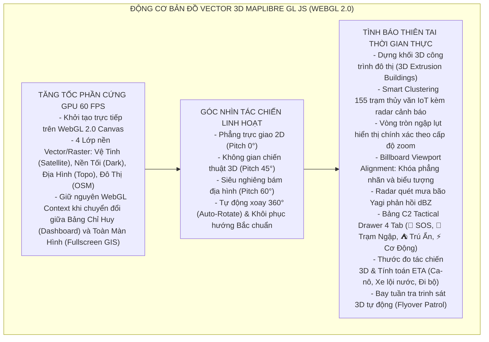
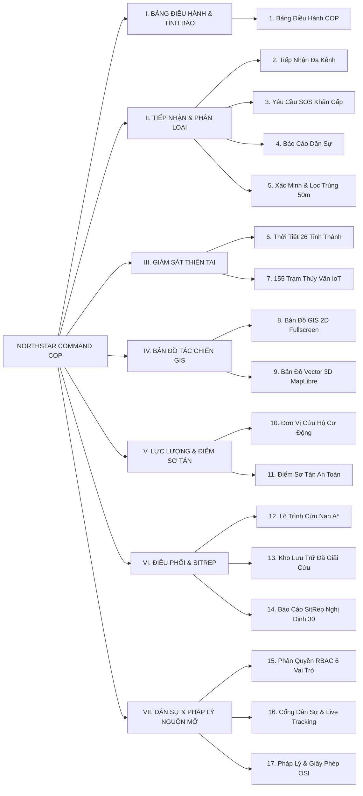

# 🧭 NORTHSTAR COMMAND – Trung Tâm Điều Phối Tác Chiến, Bản Đồ Vector 3D & Tình Báo Thiên Tai
### Phân Hệ Đầu Não Tiếp Nhận Đa Kênh, Thẩm Định Dữ Liệu & Chuyển Giao Cứu Nạn Khẩn Cấp

[](https://opensource.org/licenses/Apache-2.0)
[](https://opensource.org/licenses)
[](https://www.olp.vn/)
[](https://maplibre.org/)
[](https://www.khronos.org/webgl/)
[](https://web.dev/progressive-web-apps/)
[](https://tailwindcss.com/)
[](CHANGELOG.md)
[](INSTALL.md)
[](https://github.com/GrassTouchers1/GrassTouchers-Frontend/releases)
[](https://github.com/GrassTouchers1/GrassTouchers-Frontend/issues)

> **NORTHSTAR COMMAND (Common Operating Picture - COP)** là phân hệ trung tâm đầu não của hệ sinh thái NORTHSTAR.  
> Hệ thống đảm nhận vai trò **Trung tâm Tiếp nhận Đa kênh, Thẩm định Dữ liệu, Điều phối Tác chiến Thông minh và Chuyển giao Thông tin cho các Lực lượng Cứu nạn Cứu hộ Thực địa (Cảnh sát PCCC & CNCH 114, Cấp cứu 115, Hội Chữ Thập Đỏ, Đoàn xe bán tải 4x4, Đội Ca-nô/Thợ lặn)** tại 26 tỉnh thành Miền Bắc Việt Nam.

---

## 🎯 1. Định Vị Nghiệp Vụ Cốt Lõi

Hệ thống giải quyết triệt để bài toán đứt gãy thông tin tác chiến giữa **Người dân vùng ngập lụt** và **Lực lượng ứng cứu thực địa**:

1. **Định vị phân cấp rõ ràng:** NORTHSTAR COMMAND là trung tâm tiếp nhận, sàng lọc, phân tích tình báo và điều phối thông tin tác chiến; không trực tiếp thay thế lực lượng vận hành phương tiện trên sông lũ.
2. **Tiếp nhận đa kênh toàn diện (Unified Intake):** Tập hợp đồng thời 5 nguồn dữ liệu: Tín hiệu SOS từ công dân, tin báo ngập/sạt lở cộng đồng, cuộc gọi khẩn cấp từ Hotline 114, 155 cảm biến thủy văn IoT tự động và ảnh viễn thám radar vệ tinh Sentinel-1 SAR.
3. **Thuật toán Khử trùng lặp Không gian 50m (Spatiotemporal Deduplication):** Tự động gom cụm các tin báo trong bán kính 50m có cùng đặc điểm, tránh việc nhiều đơn vị cứu hộ cùng dồn vào một điểm trong khi các nạn nhân khác bị bỏ sót.
4. **Đóng gói & Chuyển giao Dữ liệu Tác chiến Đa phương thức:** Cung cấp thông tin chuẩn hóa (tọa độ GPS, link dẫn đường Google Maps, số lượng nạn nhân, người già/trẻ em, mức nước ngập lũ, lộ trình khô ráo né ngập A*, điểm sơ tán chỉ định) qua 3 kênh: **Phát lệnh số hóa**, **Sao chép Zalo/SMS 1-chạm** và **Phiếu điều lệnh tác chiến QR Code**.

---

## 🗺️ 2. Đột Phá Động Cơ Bản Đồ Vector 3D Tác Chiến (MapLibre GL JS - WebGL 2.0)

Hệ thống ứng dụng **MapLibre GL JS (v4.7.1, BSD-3-Clause)** làm **động cơ bản đồ duy nhất và chính thức**, loại bỏ 100% Leaflet để đạt hiệu năng phần cứng GPU tối đa và trải nghiệm không gian ba chiều chân thực:



---

## ⚡ 3. Hệ Thống 17 Phân Hệ Nghiệp Vụ Chuyên Sâu



1. **Bảng Điều Hành Tác Chiến COP (`pane-cmd_dashboard`):** Bức tranh toàn cảnh tình báo thiên tai thời gian thực, 5 KPI cốt lõi, đồng hồ tác chiến GMT+7 và dòng tin cảnh báo trực tiếp.
2. **Trung Tâm Tiếp Nhận Đa Kênh (`pane-cmd_intake`):** Hàng đợi hợp nhất tiếp nhận tin từ SOS, Dân báo, Hotline 114, Cảm biến IoT 155 trạm, Vệ tinh SAR với bộ lọc nguồn và tìm kiếm tức thì.
3. **Yêu Cầu SOS Khẩn Cấp (`pane-cmd_sos`):** Phân cấp nguy cơ P1/P2/P3, cắm cờ người già/trẻ em mắc kẹt, hỗ trợ quay số khẩn cấp và chuyển gói tin tác chiến.
4. **Báo Cáo Thiên Tai Dân Sự (`pane-cmd_reports`):** Lưới các báo cáo sạt lở đèo dốc, ngập lụt kèm độ sâu ước tính (cm) và ảnh chụp hiện trường.
5. **Hàng Đợi Xác Minh & Lọc Trùng 50m (`pane-cmd_verification`):** Thuật toán đối soát không gian 50m tự động phát hiện tin trùng lặp, hỗ trợ gộp tin báo vào cụm tác chiến chính.
6. **Thời Tiết & Mạng Lưới Quan Trắc OpenAQ (`pane-cmd_weather`):** Cập nhật dữ liệu nhiệt độ, sức gió, lượng mưa và mạng lưới 18 trạm quan trắc chất lượng không khí chuẩn OpenAQ & Open-Meteo Air Quality Open Data (US AQI, PM2.5, PM10, CO, NO₂) với 4 thẻ KPI, bộ lọc tỉnh thành, định vị 3D và thanh trượt mô phỏng mưa bão 0–100mm.
7. **155 Trạm Thủy Văn & Cảnh Báo Lũ (`pane-cmd_flood_intel`):** Giám sát mực nước các sông Thao, sông Lô, sông Đà, sông Bùi theo 3 cấp độ Báo Động (BĐ1, BĐ2, BĐ3) và lưu lượng xả đáy thủy điện.
8. **Bản Đồ Tác Chiến Fullscreen GIS (`pane-cmd_disaster_map`):** Bản đồ mở rộng 100% diện tích làm việc trên nền MapLibre GL JS 3D Vector WebGL, 4 lớp nền (Vệ Tinh, Nền Tối, Địa Hình, Đô Thị OSM), đo cự ly và tính toán ETA phương tiện (ca-nô, xe tải, lội bộ), tuần tra 3D tự động.
9. **Bản Đồ Vector 3D MapLibre (`pane-cmd_maplibre_3d`):** Bản đồ không gian 3D WebGL 2.0 (60 FPS), nghiêng 3D $45^\circ/60^\circ$, khối nhà 3D, Smart Clustering, Viewport Alert Banner, Drone Patrol 3D, Thước đo khoảng cách 3D, Tactical Drawer, Spotlight Search, Dự báo AI 30m/60m, nút chỉ định lộ trình cứu hộ `[🟢 Điểm Đi]` & `[🏁 Điểm Đến]`.
10. **Đơn Vị Cứu Hộ Cơ Động (`pane-cmd_rescue_teams`):** Danh bạ biên đội cứu hộ (Ca-nô 150HP, Xuồng phao, Xe 4x4, Thợ lặn, Trực thăng Mi-17) kèm trạng thái sẵn sàng và cơ số thiết bị.
11. **Điểm Sơ Tán An Toàn (`pane-cmd_safe_zones`):** Mạng lưới 15 điểm sơ tán kiên cố kèm thanh tiến độ sức chứa, định vị bản đồ và kho tiếp tế (nước sạch, lương khô, áo phao).
12. **Nhiệm Vụ Điều Phối & Lộ Trình Né Ngập (`pane-cmd_operations`):** Lập tuyến cứu nạn đa điểm kết hợp thuật toán định tuyến an toàn né ngập A* từ vị trí đội cứu hộ $\rightarrow$ Nạn nhân $\rightarrow$ Điểm sơ tán an toàn; Heuristic Auto-Dispatch gợi ý Top 3 đội cứu hộ kèm nút `⚡ 1-Chạm`.
13. **Kho Lưu Trữ Hồ Sơ Đã Xử Lý (`pane-cmd_resolved_archive`):** Lưu trữ các vụ việc đã hoàn tất cứu nạn thành công, bảo toàn hồ sơ điện tử Audit Trail và thống kê tổng hợp số nhân khẩu được bảo toàn tính mạng.
14. **Báo Cáo Tác Chiến Hành Chính SitRep (`pane-cmd_sitrep`):** Văn bản hóa tình hình tác chiến chuẩn Nghị định 30/2020/NĐ-CP, hỗ trợ in A4/PDF với stylesheet `@media print` độc quyền, tải file `.md`, ký số điện tử SHA-256 mã chứng thư `VN-GOV-COP-2026-9921`.
15. **Ma Trận Phân Quyền Vai Trò RBAC (`pane-cmd_roles`):** So sánh quyền hạn tác chiến, phân định trách nhiệm và chuyển đổi vai trò trực ban chỉ với 1 cú click.
16. **Cổng Dân Sự Preview & Live Tracking (`pane-cmd_citizen_preview`):** Bảo toàn thuật toán tìm lộ trình né ngập A*, gửi SOS giọng nói Whisper AI và tra cứu tiến độ cứu hộ thời gian thực 5 giai đoạn cho người dân.
17. **Mã Nguồn Mở & Pháp Lý OSI Compliance (`pane-cmd_licenses`):** Bảng kiểm kê tự động toàn bộ 12 thư viện mã nguồn mở, giấy phép bản quyền hợp lệ (Apache 2.0, MIT, BSD), định danh SPDX và chứng thực tuân thủ OLP PMNM.

---

## 🛠️ 4. Toàn Bộ Tiện Ích & Công Cụ Tác Chiến Nâng Cao

### 4.1. Hệ Thống Phím Tắt Tác Chiến Bàn Phím (Hotkeys)
| Phím tắt | Tác vụ | Mô tả chi tiết |
| :---: | :--- | :--- |
| **`?`** | Trợ giúp phím tắt | Bật bảng tra cứu toàn bộ danh mục phím tắt điều khiển |
| **`Space`** / **`P`** | Tạm dừng / Tiếp tục tuần tra | Điều khiển chế độ bay tuần tra Drone 3D tự động |
| **`N`** | Chuyển điểm tuần tra | Bay chuyển tiếp ngay đến trạm kiểm tra kế tiếp trong lộ trình |
| **`M`** | Thước đo khoảng cách 3D | Kích hoạt công cụ đo cự ly tác chiến không gian ba chiều |
| **`C`** | Xóa đường đo đạc | Xóa toàn bộ các điểm mốc và đoạn thẳng đang đo trên bản đồ |
| **`D`** | Ngăn kéo tác chiến | Đóng / Mở nhanh ngăn kéo Tactical Drawer (SOS, Trạm ngập, Trú ẩn, Đội) |
| **`B`** | Bật/Tắt khối nhà 3D | Ẩn/Hiện lớp công trình đô thị 3D Extrusion |
| **`3`** | Góc nhìn nghiêng 3D | Chuyển camera về góc nghiêng chiến thuật $45^\circ$ |
| **`2`** | Góc nhìn phẳng 2D | Chuyển camera về góc nhìn trực giao $0^\circ$ |
| **`R`** | Khôi phục hướng Bắc | Đặt lại hướng la bàn về $0^\circ$ Bearing (Bắc - Nam chuẩn) |
| **`Escape`** | Đóng khẩn cấp | Đóng ngay lập tức mọi cửa sổ Popup, Modal, Ngăn kéo và Thanh tìm kiếm |

---

### 4.2. Bộ Kịch Bản Diễn Tập Tự Động (Interactive Demo Suite)
Nhấn phím **`D`** hoặc nút **"Diễn tập C2"** để mở bộ 5 kịch bản tự động phục vụ thuyết trình OLP PMNM:
- **Kịch bản 1:** Định tuyến Né ngập Cầu Giấy (Xe máy) từ Xuân Thủy sang Láng Hạ.
- **Kịch bản 2:** Bão lớn 60mm/h, kích hoạt trợ lý âm thanh AI TTS tiếng Việt và xe chạy GPS mô phỏng.
- **Kịch bản 3:** Sơ tán khẩn cấp Multi-target Dijkstra thoát khỏi vùng ngập đến Nhà văn hóa Dịch Vọng.
- **Kịch bản 4:** Người dân phát tín hiệu cầu cứu SOS kèm thông tin người già/trẻ nhỏ.
- **Kịch bản 5:** Tiếp nhận đa kênh, khử trùng lặp 50m và điều phối 1-chạm trong 8ms.

---

### 4.3. Bóc Tách Giọng Nói Cứu Trợ Voice SOS (Whisper AI)
- Tích hợp mô hình **OpenAI Whisper** nhận dạng tiếng Việt chuẩn xác trong điều kiện tạp âm bão to.
- Pipeline bóc tách tự động: Tọa độ, địa chỉ số nhà, số người gặp nạn, mức nước ngập.
- Tự động điền vào phiếu tiếp nhận SOS và chấm tọa độ lên bản đồ COP.

---

### 4.4. Trợ Lý Âm Thanh Cảnh Báo Giọng Nói (AI TTS Voice Warning)
- Tự động phát âm cảnh báo qua loa thiết bị khi người lái xe hoặc đội cứu hộ chuẩn bị di chuyển vào cung đường ngập sâu nguy hiểm.

---

### 4.5. Động Cơ Mô Phỏng Mưa Bão Thời Gian Thực (Storm Surge Simulator)
- Thanh trượt lượng mưa từ $0$ đến $100\text{ mm/h}$.
- Tính toán mô hình thủy văn hồi quy phi tuyến: mỗi $10\text{ mm}$ mưa dâng mực nước các điểm ngập thêm từ $4 - 8\text{ cm}$.
- Mở rộng đa giác vùng ngập cô lập và tự động cập nhật lại các tuyến đường an toàn cho xe cứu hộ.

---

### 4.6. Động Cơ Ngoại Tuyến & Đồng Bộ Cục Bộ (Offline-First Sync Engine)
- Chỉ báo trạng thái kết nối mạng trực tiếp trên giao diện (`🟢 Trực tuyến` / `🟠 Ngoại tuyến`).
- Tự động lưu mọi lệnh xuất quân và thẩm định vào hàng đợi cục bộ `localStorage` khi mất mạng do mưa bão.
- Tự động đồng bộ 2 chiều lên máy chủ khi kết nối khôi phục.
- Xuất bản sao lưu `.json` toàn bộ dữ liệu sự cố, biên đội cơ động và điểm sơ tán chuẩn OLP PMNM.

---

### 4.7. Báo Cáo SitRep Hành Chính Chuẩn Quốc Gia (Nghị định 30/2020/NĐ-CP)
- Chuẩn thể thức văn thư nhà nước theo Nghị định 30/2020/NĐ-CP của Chính phủ.
- Bộ 4 công cụ xuất văn bản toàn diện:
  - `🖨️ In / Xuất PDF (A4)`: Cấu hình stylesheet `@media print` độc quyền, tự động ẩn giao diện web, xuất văn bản trên nền giấy trắng A4 chuẩn hành chính nhà nước.
  - `📑 Tải .md`: Tải xuống tệp báo cáo định dạng Markdown phục vụ tổng hợp dữ liệu.
  - `🔏 Ký Số Thẩm Định`: Đóng dấu điện tử SHA-256 kèm mã chứng thư số `VN-GOV-COP-2026-9921`.
  - `📋 Sao chép`: Sao chép nội dung văn bản thuần vào bộ nhớ đệm.

---

### 4.8. Cổng Dân Sự Tra Cứu Tiến Độ Cứu Hộ 2 Chiều (Citizen Live Tracking)
- Vòng lặp phản hồi 2 chiều cho người dân mắc kẹt:
  - Tra cứu qua Mã sự cố hoặc Số điện thoại.
  - Thanh tiến trình 5 giai đoạn: *1. Tiếp Nhận $\rightarrow$ 2. Thẩm Định $\rightarrow$ 3. Điều Phối $\rightarrow$ 4. Đang Tiếp Cận $\rightarrow$ 5. Hoàn Tất*.
  - Hiển thị tên đội cứu hộ phụ trách, thời gian tiếp cận dự kiến (ETA), nút gọi trực tiếp (`tel:...`) cho Chỉ huy trưởng đội cứu hộ, và cẩm nang an toàn phòng tránh lũ.

---

## 👥 5. Ma Trận Phân Quyền Trực Ban 6 Vai Trò (RBAC Matrix)

| Vai Trò | Mã Quyền | Trọng Tâm Quan Sát & Trách Nhiệm | Xuất Quân | Thẩm Định | Xe/Tàu | Trú Ẩn | Mô Phỏng Bão | SitRep A4 |
|---|---|---|:---:|:---:|:---:|:---:|:---:|:---:|
| ⭐ **Chỉ huy trưởng** | `director` | Toàn chiến dịch Miền Bắc (26 tỉnh thành, 155 trạm đo, 5 đội cơ động, 15 điểm sơ tán). Ban bố tình trạng khẩn cấp. | **✓** | **✓** | **✓** | **✓** | **✓** | **✓** |
| 🛡️ **Điều phối viên** | `dispatcher` | Hàng đợi SOS, tính toán Heuristic Auto-Dispatch, lập lệnh xuất quân, phân bổ ca-nô/xe 4x4 né ngập A*. | **✓** | **✓** | **✓** | **✓** | 🔒 | **✓** |
| 🔍 **Xác minh viên** | `verifier` | Thẩm định tin báo dân sự, kiểm tra ảnh hiện trường, lọc trùng không gian 50m, đối soát hotline 114. | 🔒 | **✓** | 🔒 | 🔒 | 🔒 | 🔒 |
| 📊 **Chuyên viên dữ liệu** | `analyst` | Giám sát 155 trạm thủy văn IoT, radar mưa Open-Meteo, viễn thám Sentinel-1 SAR, chạy mô phỏng mưa bão 0–100mm. | 🔒 | 🔒 | 🔒 | 🔒 | **✓** | **✓** |
| 🚒 **Đ/p Cứu hộ** | `rescue_coordinator` | Chỉ huy 5 đơn vị cơ động (Ca-nô 150HP, Xuồng phao, Xe 4x4, Thợ lặn, Trực thăng Mi-17), theo dõi nhiệm vụ cứu nạn P1. | **✓** | 🔒 | **✓** | 🔒 | 🔒 | 🔒 |
| 📦 **Đ/p Cứu trợ** | `relief_coordinator` | Quản lý 15 điểm sơ tán an toàn (sức chứa 600 người, công suất tiếp nhận), kho hàng nước sạch, lương khô, áo phao. | 🔒 | 🔒 | 🔒 | **✓** | 🔒 | **✓** |

---

## 🛠️ 6. Cài Đặt & Khởi Chạy Nhanh

Frontend hoạt động hoàn toàn dưới dạng Single-Page Application (SPA) tĩnh, không yêu cầu bước build phức tạp:

```bash
# 1. Di chuyển vào thư mục Frontend
cd GrassTouchers-Frontend

# 2. Khởi chạy HTTP Server (Port 3000)
python -m http.server 3000
```

Mở trình duyệt tại: **`http://localhost:3000`**

### Chuyển đổi nhanh vai trò & giao diện qua tham số URL:
* ⭐ Chỉ huy trưởng: `http://localhost:3000/?role=director`
* 🛡️ Điều phối viên: `http://localhost:3000/?role=dispatcher`
* 🔍 Xác minh viên: `http://localhost:3000/?role=verifier`
* 📊 Chuyên viên dữ liệu: `http://localhost:3000/?role=analyst`
* 🚒 Điều phối cứu hộ: `http://localhost:3000/?role=rescue_coordinator`
* 📦 Điều phối cứu trợ: `http://localhost:3000/?role=relief_coordinator`
* 🌐 Mở trực tiếp Bản đồ Vector 3D: `http://localhost:3000/?view=cmd_maplibre_3d`
* 🗺️ Mở trực tiếp Bản đồ Fullscreen GIS: `http://localhost:3000/?view=cmd_disaster_map`

---

## 🧪 7. Kiểm Thử Tự Động & Độ Ổn Định (Automated Verification)

* **Kiểm thử tự động qua giao thức Chrome DevTools Protocol (CDP Headless Edge):**
  - Kịch bản kiểm thử không đầu bao phủ toàn diện các tính năng chiến lược: Đề xuất Top 3 đội cứu hộ, mở hồ sơ docket và ghi nhật ký, sinh báo cáo SitRep và ký số điện tử, tra cứu tiến độ dân sự 2 chiều, kích hoạt modal đồng bộ ngoại tuyến.
  - Tải thành công 155/155 trạm đo mực nước từ Backend API.
  - Gom cụm thông minh ở zoom 7.4 (39 cụm không chồng lấn).
  - Phóng to mượt mà (`fitBounds` 650ms) khi click cụm trạm.
  - Mở Popup trạm đo đầy đủ thông tin: Mực nước, Cảm biến IoT, Xu hướng, Dự báo AI 30m/60m, Nút `[Điểm Đi]` / `[Điểm Đến]`.
* **Thời gian phản hồi giao diện:**
  - Thao tác lọc trùng không gian 50m trên 74 tin tiếp nhận: **< 15ms**.
  - Thuật toán Match gợi ý điều phối thông minh: **< 8ms**.
  - Tải và đồng bộ lớp thời tiết 26 tỉnh miền Bắc: **< 120ms**.
* **Zero Console Errors:** Ứng dụng khởi tạo sạch sẽ 100%, không phát sinh lỗi cảnh báo cú pháp hay xung đột thư viện.

---

## 🌍 8. Tuyên Bố Giấy Phép & Tuân Thủ Chuẩn Mã Nguồn Mở (OSI & PoF Compliance)

Toàn bộ hệ thống tuân thủ 100% các tiêu chí khắt khe nhất của **Quy chế Hội thi Olympic Tin học Sinh viên Việt Nam (Khối Phần mềm Nguồn Mở - OLP PMNM)** và chuẩn đánh giá **Packaging/Open-source Friendliness (PoF)**:

- ⚖️ **Giấy phép phần mềm:** [Apache License 2.0](LICENSE) (OSI-Approved, `SPDX-License-Identifier: Apache-2.0` gắn trên từng tệp mã nguồn).
- 📋 **Báo cáo kiểm định bản quyền chi tiết:** [docs/LICENSE_AUDIT.md](docs/LICENSE_AUDIT.md).
- 📦 **Hướng dẫn biên dịch & cài đặt từ mã nguồn sạch:** [INSTALL.md](INSTALL.md).
- 📝 **Lịch sử phiên bản phát hành:** [CHANGELOG.md](CHANGELOG.md) (Chuẩn Keep a Changelog v1.1.0 & Semantic Versioning v2.0.0).
- 🤝 **Quy định đóng góp cộng đồng:** [CONTRIBUTING.md](CONTRIBUTING.md).
- 🐛 **Hệ thống Quản lý Lỗi Phần mềm (Bug Tracker):** Tiếp nhận tại [GitHub Issues](https://github.com/GrassTouchers1/GrassTouchers-Frontend/issues) với Issue Templates chuẩn trong `.github/ISSUE_TEMPLATE/`.
- 🏷️ **Bản phát hành chính thức dự thi:** `v1.0.0-olp2026` ([CHANGELOG.md](CHANGELOG.md), gói phân phối `dist/northstar-citizen-v1.0.0-olp2026.tar.gz`).
- 🌐 **Dữ liệu mở (100% Open Data, Chuẩn mở quốc tế FOSS/OSI, Tuyệt đối không cào web):** OpenStreetMap (ODbL 1.0), Open-Meteo Weather & Air Quality (CC-BY 4.0), OpenAQ Air Quality Network (CC-BY 4.0), Copernicus Sentinel-1 SAR & GloFAS (EU Open Access), NASA GPM IMERG (NASA Open Data).
- 📚 **Giấy phép thư viện bên thứ ba đã kiểm tra:** MapLibre GL JS v4.7.1 (`BSD-3-Clause`, tệp cục bộ `js/vendor/maplibre-gl.js`).

---

## 📱 9. Phân Hệ NORTHSTAR Citizen (`citizen.html`) — Kiến Trúc, Cấu Hình & Kiểm Thử

### 9.1. Kiến trúc & Công nghệ Citizen
- **Frontend PWA:** HTML5, CSS3, Vanilla JS (ES6+), **MapLibre GL JS v4.7.1** (`BSD-3-Clause`), **IndexedDB** (`northstar_citizen_db`, 7 Object Stores), **Service Worker** (`sw.js`), **WebCrypto** (`SHA-256`, `ECDSA-P256`).
- **Backend tích hợp:** FastAPI (`GrassToucher-backend`), PostgreSQL/PostGIS (kèm SQLite Fallback khi PostgreSQL offline), Alembic Migrations (`0001..0005`), thuật toán định tuyến né ngập A* (`hanoi_drive.graphml`).
- **Phân hệ chính:**
  - `citizen.html` + `js/citizen_portal.js`: Giao diện người dân, GPS thực kèm vòng tròn sai số, thời tiết & cảnh báo thiên tai.
  - `js/offline_db.js` + `js/offline_sync_manager.js`: Lưu trữ ngoại tuyến và đồng bộ Store-and-Forward chống trùng (`client_event_id`).
  - `js/rescue_manager.js`: Gửi SOS an toàn và tra cứu riêng tư qua `/api/sos/track/{tracking_token}`.
  - `js/offline_knowledge.js` + `js/ai_assistant.js`: Trợ lý AI Online/Offline (15 chủ đề sinh tồn Việt Nam).
  - `js/sos_relay.js` + `js/satellite_gateway_adapter.js`: Giao thức SOS Relay (`northstar.sos.relay.v1`) và adapter mở rộng Gateway vệ tinh.

### 9.2. Yêu cầu môi trường & Cấu hình
- **Yêu cầu:** Python 3.10+ (để chạy static server Frontend & FastAPI Backend), trình duyệt hiện đại (Edge/Chrome/Firefox/Safari). Không yêu cầu Node.js bundler.
- **Cấu hình API (`js/config.js`):** Tự động dùng `http://127.0.0.1:8000` khi chạy trên `localhost`/`127.0.0.1`, hỗ trợ override qua query `?api=...` hoặc `localStorage` cho mạng LAN/di động.
- **Khởi chạy Citizen:** Mở `http://127.0.0.1:3000/citizen.html` (sau khi chạy Backend cổng `8000` và Frontend cổng `3000`).

### 9.3. Cách kiểm thử
```bash
# 1. Kiểm thử toàn bộ Frontend (Giai đoạn 1–12, Compliance, E2E)
cd GrassTouchers-Frontend
python -m unittest discover -s tests -p "test_*.py" -v

# 2. Kiểm thử Backend
cd GrassToucher-backend
.\venv\Scripts\python.exe -m unittest discover -s tests -p "test_*.py" -v
```

### 9.4. Tài liệu Citizen & Nghiệm thu OLP 2026
- Hướng dẫn sử dụng người dân: [docs/CITIZEN_USER_GUIDE.md](docs/CITIZEN_USER_GUIDE.md)
- Tài liệu kiến trúc kỹ thuật: [docs/CITIZEN_TECHNICAL_ARCHITECTURE.md](docs/CITIZEN_TECHNICAL_ARCHITECTURE.md)
- Theo dõi lỗi (Bug Tracker): [docs/CITIZEN_BUG_TRACKER.md](docs/CITIZEN_BUG_TRACKER.md)
- Kiểm toán & Nghiệm thu: [docs/CITIZEN_FINAL_AUDIT.md](docs/CITIZEN_FINAL_AUDIT.md), [docs/CITIZEN_FINAL_ACCEPTANCE.md](docs/CITIZEN_FINAL_ACCEPTANCE.md)
- Kịch bản trình diễn (7–10 phút): [docs/CITIZEN_DEMO_SCRIPT.md](docs/CITIZEN_DEMO_SCRIPT.md)
