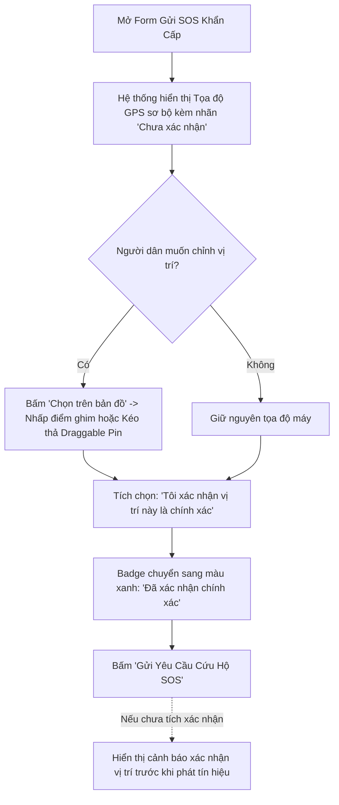

<!--
  Copyright (C) 2026 NORTHSTAR Contributors
  Licensed under the Apache License, Version 2.0 (the "License");
  you may not use this file except in compliance with the License.
  You may obtain a copy of the License at:
      http://www.apache.org/licenses/LICENSE-2.0
  Unless required by applicable law or agreed to in writing, software
  distributed under the License is distributed on an "AS IS" BASIS,
  WITHOUT WARRANTIES OR CONDITIONS OF ANY KIND, either express or implied.
  See the License for the specific language governing permissions and
  limitations under the License.
-->

# 📍 ĐẶC TẢ KỸ THUẬT QUY TRÌNH XÁC THỰC TỌA ĐỘ HIỆN TRƯỜNG (CITIZEN LOCATION VERIFICATION SPEC)
**Phân hệ:** NORTHSTAR Citizen (Victim Portal)  
**Phụ trách:** Thành viên 1  
**Mã công việc:** `VIC-04` (Bản đồ người dân & điểm hỗ trợ)  
**Tiêu chí nghiệm thu:** `V-04` (*"Vị trí có thể được người dùng xác nhận/chỉnh sửa; không mặc định luôn chính xác."*)  

---

## 1. BỐI CẢNH & NGUYÊN TẮC THIẾT KẾ
Trong bối cảnh mưa lũ đô thị hoặc sạt lở đất đá:
1. **Sai số GPS thiết bị di động:** Sai số có thể lên đến 50m – 100m do phản xạ tín hiệu từ nhà cao tầng hoặc mây dông bão mù mịt.
2. **Nạn nhân bị cô lập cục bộ:** Một sai lệch 20m có thể khiến lực lượng cứu hộ tiếp cận nhầm phía bên kia của con đê hoặc một ngõ cụt ngập sâu không thể đi qua.
3. **Nguyên tắc "Không mặc định luôn chính xác" (Tiêu chí V-04):** Hệ thống không bao giờ tự ý gửi tọa độ GPS mặc định nếu người dân chưa được xem, tùy chỉnh và xác nhận điểm ghim trên nóc nhà thực tế.

---

## 2. QUY TRÌNH TƯƠNG TÁC 3 BƯỚC CỦA NGƯỜI DÂN



---

## 3. CẤU TRÚC DỮ LIỆU & GIAO DIỆN

### 3.1. Các thành phần giao diện (UI Components)
* **Khung hiển thị tọa độ:** `#citizen-sos-coord-display` (Hiển thị kinh/vĩ độ định dạng 4 chữ số thập phân).
* **Nút lấy vị trí GPS tự động:** `#btn-citizen-gps-locate` (Kích hoạt Geolocation API độ chính xác cao).
* **Chỉ số bán kính sai số GPS:** `#citizen-gps-accuracy` (Đo độ lệch vị trí thực tế `±Xm` kèm vòng tròn sai số Leaflet).
* **Nút kích hoạt ghim bản đồ:** `#btn-citizen-pick-sos` (Chuyển con trỏ bản đồ sang dạng `crosshair` và bật thanh tác chiến).
* **Thanh công cụ tác chiến nổi:** `#citizen-picking-toolbar` (Thanh glassmorphism nổi trên bản đồ gồm nút GPS, Xác nhận, Hủy).
* **Ghim cứu hộ động:** `citizen-sos-custom-pin` (Marker dạng `draggable`, hỗ trợ kéo thả trực tiếp đến vị trí mong muốn).
* **Vòng tròn sai số định vị:** `accuracyCircle` (Vòng tròn màu ngọc lục bảo biểu thị khoảng sai số xung quanh vị trí ghim).
* **Phản hồi xúc giác (Haptic Feedback):**
  * Chạm ghim / bắt đầu kéo: rung nhẹ 30ms.
  * Thả ghim / di chuyển tọa độ: rung 3 nhịp [40ms, 30ms, 40ms].
  * Xác nhận vị trí: rung xác thực [60ms, 40ms, 60ms].
* **Nhãn trạng thái xác minh:** `#citizen-loc-verify-badge`
  * `Chưa xác nhận` (Vàng - `citizen-loc-unverified`)
  * `Đã xác nhận chính xác` (Xanh lá - `citizen-loc-verified`)
* **Hộp kiểm xác nhận:** `#citizen-confirm-location-check`

### 3.2. Payload gửi lên máy chủ
```json
{
  "contact_name": "Nguyễn Văn A",
  "phone": "0987654321",
  "lat": 21.0285,
  "lng": 105.8542,
  "people_count": 3,
  "has_elderly_or_children": true,
  "water_level_cm": 45.0,
  "priority": "critical",
  "location_verified_by_user": true,
  "notes": "Nước ngập tầng 1, cần xuồng cứu trợ"
}
```

---

## 4. TIÊU CHÍ ĐÁNH GIÁ CHẤM THI OLP PMNM 2026
* [x] **Tuân thủ bản quyền:** Tệp mã nguồn mang License Header Apache-2.0 chuẩn OSI.
* [x] **Thân thiện với người dùng di động:** Thao tác kéo thả ghim bằng ngón tay mượt mà trên màn hình cảm ứng điện thoại.
* [x] **Bảo vệ an toàn thông tin:** Tọa độ chỉ được truyền tải qua API nội bộ, không phụ thuộc dịch vụ bản đồ thương mại đóng.
