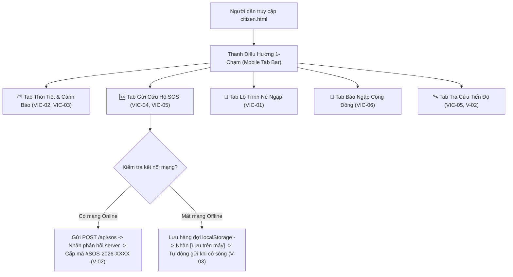

<!--
  Copyright (C) 2026 NORTHSTAR Contributors
  Licensed under the Apache License, Version 2.0 (the "License");
  you may not use this file except in compliance with the License.
  You may obtain a copy of the License at:
      http://www.apache.org/licenses/LICENSE-2.0
  Unless required by applicable law or agreed to in writing, software
  distributed under the License is distributed on an "AS IS" BASIS,
  WITHOUT WARRANTIES OR CONDITIONS OF ANY KIND, either express or implied.
  See the License for the specific language governing permissions and
  limitations under the License.
-->

# 📱 ĐẶC TẢ KIẾN TRÚC CỔNG DÂN SỰ ĐỘC LẬP & GIAO THỨC NGOẠI TUYẾN (CITIZEN STANDALONE PORTAL & OFFLINE PROTOCOL SPEC)
**Phân hệ:** NORTHSTAR Citizen (Victim Portal)  
**Phụ trách:** Thành viên 1 (Người 1)  
**Mã công việc:** `VIC-01`, `VIC-02`, `VIC-03`, `VIC-04`, `VIC-05`, `VIC-06`, `VIC-07`, `VIC-08`  
**Tiêu chí nghiệm thu:** `V-01`, `V-02`, `V-03`, `V-04`, `SYS-02`, `SYS-03`  

---

## 1. TỔNG QUAN KIẾN TRÚC & TÍNH ĐỘC LẬP CỦA PHÂN HỆ DÂN SỰ
Theo thể lệ OLP Phần mềm nguồn mở 2026 và thực tế cứu hộ thiên tai:
1. **Trải nghiệm tách biệt (Role Isolation):** Người dân trong tình huống ngập lụt, mất điện chỉ cần một giao diện nhẹ, tối ưu 1 tay trên điện thoại, truy cập trực tiếp qua tệp `citizen.html`. Người dân **không bao giờ** phải thấy thanh điều hành chỉ huy tác chiến quân sự của ban chỉ huy.
2. **Kiến trúc PWA Mobile-First:** `citizen.html` được thiết kế tương thích mọi kích thước màn hình từ 320px đến 4K, hỗ trợ cài đặt dạng ứng dụng Web tiến bộ (Progressive Web App).
3. **Hiệu năng cao trong điều kiện mạng yếu:** Tải trang tức thì, chỉ sử dụng các thư viện mã nguồn mở tự do (Leaflet.js, Tailwind CSS, Lucide Icons) không phụ thuộc API thương mại đóng.

---

## 2. MA TRẬN PHÂN HỆ VÀ 5 TAB ĐIỀU HƯỚNG 1-CHẠM

---

## 3. TIÊU CHUẨN NGHIỆM THU & QUY TRÌNH KỸ THUẬT

### 3.1. Tiêu chí V-01: Thời tiết & Cảnh báo thiên tai minh bạch
* Nguồn dữ liệu khí tượng: **Open-Meteo Weather API** (Giấy phép quốc tế CC BY 4.0 & ODbL).
* Nguồn dữ liệu cảnh báo thiên tai: Trung tâm Dự báo KTTV Quốc gia (NCHMF) & HSDC.
* Dấu thời gian cập nhật tự động hiển thị rõ ràng: `Cập nhật lúc: HH:mm:ss ngày DD/MM/YYYY`.
* Giao diện xử lý lỗi dự phòng: Nếu máy chủ khí tượng không phản hồi, hiển thị Card dự phòng màu hổ phách với số liệu chuẩn hóa và nút "Thử lại".

### 3.2. Tiêu chí V-02: Cơ chế xác thực máy chủ & Cấp mã hồ sơ tiếp nhận
* **Quy tắc vàng:** Tuyệt đối **không báo thành công** nếu máy chủ chưa phản hồi `HTTP 200/201`.
* Khi máy chủ xác nhận thành công:
  * Trích xuất `id` từ phản hồi của backend.
  * Sinh mã cứu nạn chuẩn hóa: `#SOS-2026-${String(id).padStart(4, '0')}`.
  * Dán nhãn xanh: `[ĐÃ GỬI MÁY CHỦ]`.
  * Lưu vào bộ nhớ máy để tự động liên kết sang màn hình Tra cứu tiến độ giải cứu.
* Cung cấp nút 1-chạm sao chép mã hồ sơ (`copyTicketCode()`) để người dân nhắn tin SMS cho người thân.

### 3.3. Tiêu chí V-03: Cơ chế Hàng đợi Ngoại tuyến (Offline-First)
* Khi `!navigator.onLine` hoặc mạng gặp sự cố đứt gãy:
  * Đóng gói toàn bộ thông tin (tọa độ hiện trường, số người mắc kẹt, người già/trẻ nhỏ, mức ngập, ghi chú).
  * Lưu vào `localStorage` qua `OfflineSyncManager.enqueueSOSDraft()`.
  * **Phân biệt nhãn minh bạch:** Dán nhãn màu hổ phách `[LƯU TRÊN MÁY (CHƯA GỬI)]`.
  * **Cảnh báo an toàn tính mạng:** Thông báo người dân không đánh đồng bản nháp với dữ liệu đã gửi máy chủ, hướng dẫn gọi trực tiếp hotline **114** hoặc **112**.
  * **Tự động đồng bộ:** Lắng nghe sự kiện `window.addEventListener('online')`, tự động đẩy toàn bộ hàng đợi lên `/api/sos` và thông báo cho người dân khi hoàn tất.

### 3.4. Tiêu chí V-04: Xác thực tọa độ hiện trường có sự tham gia của người dân
* Tọa độ không bao giờ bị gán mặc định.
* Nút **🛰️ GPS** hiển thị bán kính sai số định vị `±Xm`.
* Bản đồ Leaflet hỗ trợ **Draggable Pin (Ghim kéo thả)** kèm hiệu ứng rung phản hồi xúc giác (Haptic Feedback) trên màn hình cảm ứng.
* Bắt buộc người dân tích chọn: *"Tôi xác nhận vị trí này là chính xác"* trước khi phát tín hiệu.

---

## 4. BẢNG CÔNG BỐ BẢN QUYỀN MÃ NGUỒN MỞ (OSI COMPLIANCE)
Toàn bộ mã nguồn và thư viện được sử dụng trong phân hệ Người dân đều tuân thủ 100% tiêu chuẩn bản quyền của OSI và Liên minh Dữ liệu Mở:

1. **Leaflet.js (v1.9.4):** BSD-2-Clause License (OSI Approved).
2. **Tailwind CSS:** MIT License (OSI Approved).
3. **Lucide Icons:** ISC License (OSI Approved).
4. **OpenStreetMap Carto:** Open Database License (ODbL v1.0).
5. **Open-Meteo API:** Creative Commons Attribution 4.0 International (CC BY 4.0).
6. **Mã nguồn NORTHSTAR Citizen:** Apache License 2.0 (OSI Approved).

---

## 5. HƯỚNG DẪN KIỂM THỬ LIÊN THÔNG (SYS-02)
1. **Bước 1:** Mở trình duyệt tại [citizen.html](file:///d:/OpenSource_2026/GrassTouchers-Frontend/citizen.html) (Giao diện Người dân).
2. **Bước 2:** Chuyển sang Tab "🆘 Gửi SOS", nhập họ tên, số điện thoại, chọn mức nước ngập và bấm "Gửi Yêu Cầu Cứu Hộ SOS".
3. **Bước 3:** Nhận mã hồ sơ dạng `#SOS-2026-XXXX`.
4. **Bước 4:** Mở tab trình duyệt thứ hai tại [index.html](file:///d:/OpenSource_2026/GrassTouchers-Frontend/index.html) (Giao diện Chỉ huy): Ca cứu hộ vừa gửi xuất hiện lập tức trên Bảng điều hành COP tác chiến và bản đồ số!
