# SƠ ĐỒ ĐIỀU HƯỚNG TỔNG THỂ NORTHSTAR COMMAND
## COMMAND NAVIGATION MAP (PHASE 2)

**Hệ thống:** NORTHSTAR COMMAND  
**Mục tiêu:** Định hình cấu trúc cây điều hướng (Navigation Tree) 8 khối nghiệp vụ dành cho Điều phối viên, Quản trị viên và Chuyên viên giám sát thiên tai.  

---

## 1. SƠ ĐỒ ĐIỀU HƯỚNG CÂY CHỨC NĂNG (NAVIGATION HIERARCHY)

```mermaid
graph TD
  Root["NORTHSTAR COMMAND (Trung Tâm Điều Hành)"]

  %% 1. OVERVIEW
  Root --> N1["1. OVERVIEW"]
  N1 --> M1_1["Command Dashboard (COP - Màn hình mặc định)"]

  %% 2. INFORMATION CENTER
  Root --> N2["2. INFORMATION CENTER"]
  N2 --> M2_1["Information Hub (Tiếp nhận đa nguồn thời gian thực)"]
  N2 --> M2_2["SOS Requests (Hàng đợi SOS & Yêu cầu cứu hộ khẩn)"]
  N2 --> M2_3["Disaster Reports (Báo cáo ngập lụt hiện trường)"]
  N2 --> M2_4["Verification Queue (Hàng chờ thẩm tra & Phân loại AI)"]

  %% 3. DISASTER MONITORING
  Root --> N3["3. DISASTER MONITORING"]
  N3 --> M3_1["Weather Monitoring (Thời tiết Open-Meteo & Gió bão)"]
  N3 --> M3_2["Storm Tracking (Mô phỏng đường đi bão & Áp thấp)"]
  N3 --> M3_3["Rainfall Monitoring (Lượng mưa theo giờ & Vệ tinh GPM)"]
  N3 --> M3_4["River Water Levels (Mực nước trạm thủy văn Sông Hồng/Lô/Bùi)"]
  N3 --> M3_5["Flood Intelligence (Trí tuệ ngập lụt & Viễn thám Sentinel-1)"]

  %% 4. GIS & MAP
  Root --> N4["4. GIS & MAP"]
  N4 --> M4_1["Disaster Map (Bản đồ tác chiến tổng hợp đa lớp)"]
  N4 --> M4_2["Hazard Zones (Vùng thiên tai, lũ quét & sạt lở)"]
  N4 --> M4_3["Rescue Locations (Điểm xảy ra sự cố cần ứng cứu)"]
  N4 --> M4_4["Safe Zones (Mạng lưới điểm sơ tán an toàn)"]
  N4 --> M4_5["Infrastructure (Hệ thống đê điều, hồ chứa & giao thông)"]

  %% 5. RESOURCE MANAGEMENT
  Root --> N5["5. RESOURCE MANAGEMENT"]
  N5 --> M5_1["Rescue Teams (Đội cứu hộ chuyên nghiệp 114, 115)"]
  N5 --> M5_2["Volunteer Organizations (Tổ chức thiện nguyện & Đoàn xe 4x4)"]
  N5 --> M5_3["Vehicles & Equipment (Ca nô, xuồng phao, xe lội nước)"]
  N5 --> M5_4["Relief Resources (Kho lương khô, nước sạch & thuốc men)"]

  %% 6. COMMAND OPERATIONS
  Root --> N6["6. COMMAND OPERATIONS"]
  N6 --> M6_1["Rescue Missions (Lệnh điều phối cứu nạn khẩn cấp)"]
  N6 --> M6_2["Relief Missions (Kế hoạch phân phối hàng cứu trợ)"]
  N6 --> M6_3["Evacuation Support (Điều hướng sơ tán cộng đồng)"]
  N6 --> M6_4["Task Assignments (Phân công nhiệm vụ lực lượng)"]
  N6 --> M6_5["Operation History (Lịch sử tác chiến & Hồ sơ ca cứu hộ)"]

  %% 7. REPORTS
  Root --> N7["7. REPORTS"]
  N7 --> M7_1["Situation Reports (SitRep tác chiến PCTT QĐ 18)"]
  N7 --> M7_2["Operational Statistics (Thống kê đô thị & Phân tích rủi ro)"]
  N7 --> M7_3["Data Sources (Minh bạch dữ liệu mở OSI / ODbL)"]
  N7 --> M7_4["Audit Logs (Nhật ký thao tác điều phối bất biến)"]

  %% 8. SYSTEM
  Root --> N8["8. SYSTEM"]
  N8 --> M8_1["User Management (Danh bạ tài khoản & Đầu mối liên hệ)"]
  N8 --> M8_2["Roles & Permissions (Ma trận phân quyền 6 vai trò)"]
  N8 --> M8_3["System Settings (Cấu hình trạm & Thông số kết nối API)"]
```

---

## 2. MA TRẬN MÀN HÌNH VÀ HÀNH ĐỘNG TƯƠNG ỨNG

| Mã menu | Tên màn hình / Mục chức năng | Loại view hiển thị | Hành động nghiệp vụ chính |
|---|---|---|---|
| `cmd_dashboard` | **Command Dashboard** | Map + COP Split Screen | Nắm bắt toàn cảnh 6 thẻ KPI, xem dòng tin nóng, lia nhanh sự cố trên bản đồ |
| `cmd_intake` | **Information Hub** | Data Table / Card Feed | Tiếp nhận dòng tin từ 5 nguồn, lọc theo độ ưu tiên, xác thực, khử trùng lặp 50m |
| `cmd_sos` | **SOS Requests** | Data Table + Detail Drawer | Xem chi tiết nạn nhân, người già/trẻ nhỏ, mở popup phân công đội cứu hộ |
| `cmd_disaster_reports`| **Disaster Reports** | Card Grid + Geo Filter | Đối soát báo cáo ngập lụt từ cộng đồng với số đo cảm biến thủy văn lân cận |
| `cmd_weather` | **Weather & Storm Monitoring** | Weather Widget + Charts | Xem nhiệt độ, độ ẩm, gió bão từ Open-Meteo và kịch bản mưa dâng |
| `cmd_flood_intel` | **Flood Intelligence** | Hydrology Table + SAR Polygon | Giám sát mực nước các trạm Sông Hồng, Sông Cầu, xem vết ngập vệ tinh Sentinel-1 |
| `cmd_hazard_map` | **Disaster Map** | Fullscreen GIS Leaflet | Bật/tắt 5 lớp bản đồ chuyên dụng, đo khoảng cách, chuyển vùng nhanh |
| `cmd_rescue_teams` | **Rescue Teams** | Fleet Table + Map Pins | Xem trạng thái trực ban của các đội Ca nô 114, Xuồng phao Chữ thập đỏ, Đội 4x4 |
| `cmd_shelters` | **Safe Zones & Shelters** | Capacity Progress List | Xem sức chứa, tỷ lệ lấp đầy, số điện thoại trạm trưởng các điểm sơ tán |
| `cmd_dispatch` | **Command Operations** | Mission Board + TSP Route | Phân công đội cứu hộ, vẽ tuyến đường tác chiến (Đội -> Nạn nhân -> Trạm sơ tán) |
| `cmd_sitrep` | **Situation Reports** | Document Viewer / Exporter | Tự động tạo văn bản Báo cáo Tác chiến PCTT, 1-Click sao chép gửi Ban Chỉ huy |
| `cmd_roles` | **Roles & Permissions** | Access Matrix Viewer | Kiểm tra quyền hạn của Command Director, Dispatcher, Verifier, Analyst |

---
*Bản đồ điều hướng được chuẩn hóa theo mô hình Hệ thống Điều hành Khẩn cấp Quốc gia.*
