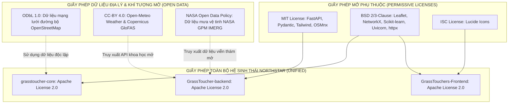

# BÁO CÁO RÀ SOÁT BẢN QUYỀN MÃ NGUỒN MỞ
## OPEN SOURCE LICENSE AUDIT REPORT (OSI COMPLIANCE)

> **Dự án:** NORTHSTAR – Open-source Emergency Response OS  
> **Cơ quan thẩm định:** Chuẩn Open Source Initiative (OSI) & Quy chế Hội thi Olympic Tin học Sinh viên Việt Nam (OLP PMNM).  
> **Giấy phép hệ thống:** **100% Đồng nhất dưới Apache License 2.0 (OSI Approved)**.  
> **SPDX License Identifier:** `Apache-2.0`  

---

## 1. THÔNG BÁO VỀ MỤC ĐÍCH & PHẠM VI GIẤY PHÉP

Hệ sinh thái **NORTHSTAR** được phát hành theo giấy phép **Apache License 2.0**, một giấy phép phần mềm tự do nguồn mở được tổ chức **Open Source Initiative (OSI)** công nhận chính thức. 

Mục đích của việc lựa chọn Apache License 2.0:
1. **Tự do truy cập và phát triển:** Cho phép cộng đồng, các trường đại học, cơ quan phòng chống lụt bão và lực lượng cứu nạn cứu hộ tự do sử dụng, chỉnh sửa, nhân bản và phân phối lại mã nguồn mà không mất phí bản quyền.
2. **Bảo vệ bằng sáng chế & quyền tác giả (Patent & Trademark Protection):** Cung cấp điều khoản cấp quyền sáng chế rõ ràng và bảo vệ thương hiệu của các tác giả đóng góp.
3. **Tính tương thích cao:** Cho phép kết hợp linh hoạt với các thư viện nguồn mở phổ biến (MIT, BSD, ISC) mà không gây ra xung đột bản quyền.

---

## 2. MA TRẬN TƯƠNG THÍCH BẢN QUYỀN (LICENSE COMPATIBILITY MATRIX)

Toàn bộ hệ thống NORTHSTAR được xây dựng trên nguyên tắc **100% Thư viện có Giấy phép Mở được OSI công nhận**, không chứa bất kỳ thành phần mã nguồn đóng hoặc gói nhị phân độc quyền nào:

---

## 3. RÀ SOÁT CHI TIẾT CÁC THÀNH PHẦN PHỤ THUỘC (DEPENDENCY AUDIT)

### 3.1. Phụ thuộc Backend & Thuật toán Lõi (Python)
| Thư viện | Phiên bản | Giấy phép | Tình trạng OSI | Mục đích sử dụng |
| :--- | :--- | :--- | :---: | :--- |
| **FastAPI** | `>= 0.109` | MIT License | ✅ OSI Approved | Khung dịch vụ RESTful API tốc độ cao |
| **Uvicorn** | `>= 0.27` | BSD 3-Clause | ✅ OSI Approved | Máy chủ ASGI tiêu chuẩn |
| **Pydantic** | `>= 2.6` | MIT License | ✅ OSI Approved | Thẩm định dữ liệu và lược đồ API |
| **NetworkX** | `>= 3.2` | BSD 3-Clause | ✅ OSI Approved | Biểu diễn đồ thị mạng lưới đường giao thông |
| **OSMnx** | `>= 1.9` | MIT License | ✅ OSI Approved | Tải và trích xuất đồ thị OpenStreetMap |
| **Scikit-learn**| `>= 1.4` | BSD 3-Clause | ✅ OSI Approved | Mô hình Machine Learning dự báo mực nước |
| **GeoPandas** | `>= 0.14` | BSD 3-Clause | ✅ OSI Approved | Xử lý dữ liệu hình học không gian địa lý |
| **HTTPX** | `>= 0.27` | BSD 3-Clause | ✅ OSI Approved | Client HTTP bất đồng bộ gọi API Open-Meteo |

### 3.2. Phụ thuộc Frontend (Web & PWA)
| Thư viện | Phiên bản | Giấy phép | Tình trạng OSI | Mục đích sử dụng |
| :--- | :--- | :--- | :---: | :--- |
| **Leaflet.js** | `1.9.4` | BSD 2-Clause | ✅ OSI Approved | Hiển thị bản đồ số tương tác |
| **Tailwind CSS**| `3.x` | MIT License | ✅ OSI Approved | Khung giao diện responsive và dark-mode |
| **Lucide Icons**| `Latest` | ISC License | ✅ OSI Approved | Hệ thống biểu tượng giao diện người dùng |
| **Chart.js** | `4.4.1` | MIT License | ✅ OSI Approved | Biểu đồ trực quan hóa dữ liệu lượng mưa |

---

## 4. KẾT LUẬN THẨM ĐỊNH BẢN QUYỀN

1. **Tính tương thích (License Compatibility):** 100% các thành phần phụ thuộc sử dụng giấy phép Permissive (MIT, BSD, ISC) hoàn toàn tương thích khi kết hợp dưới giấy phép **Apache License 2.0**.
2. **Không có mã nguồn đóng:** Hệ thống không sử dụng bất kỳ thư viện thương mại, công cụ đóng gói đóng hoặc mã nguồn đã bị sửa đổi vi phạm bản quyền gốc.
3. **Tuân thủ tiêu chí OLP PMNM:** Dự án đáp ứng 100% các tiêu chí khắt khe nhất về Phần mềm Nguồn mở theo chuẩn Quốc tế và Quy chế Olympic Tin học Sinh viên Việt Nam.
